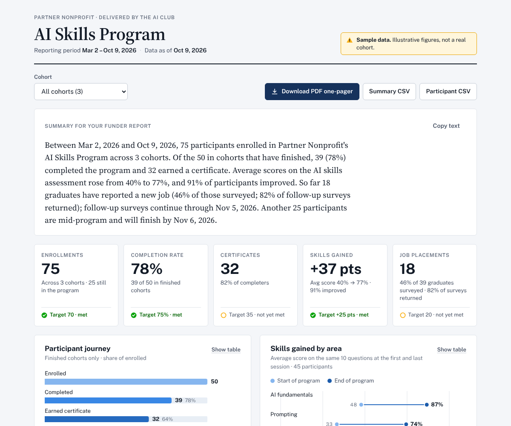
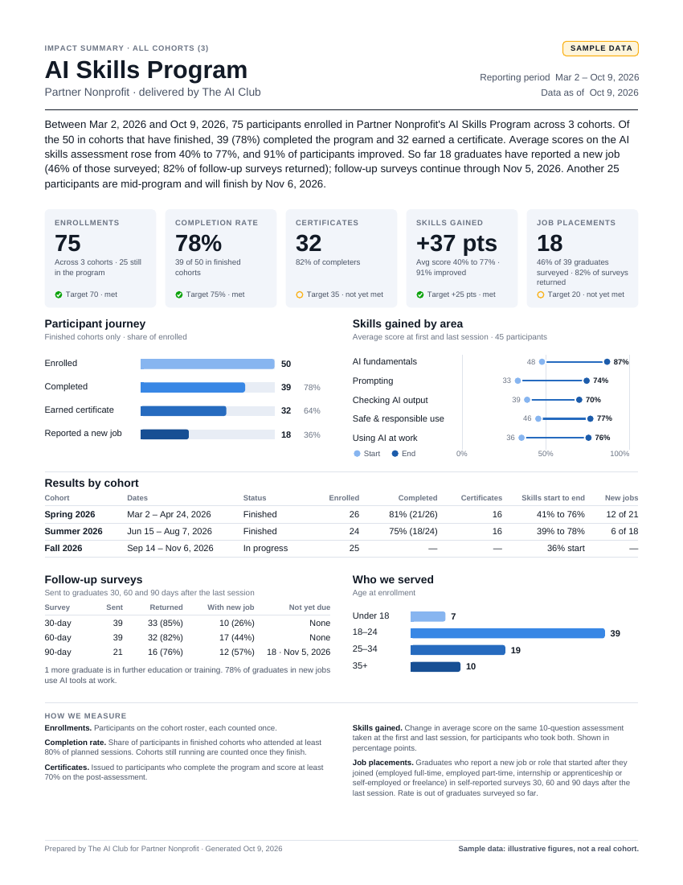

# AI Club Impact Dashboard

A funder-ready reporting dashboard for The AI Club's partner programs. It gives
a partner (first: Mark) a live view of how their AI program is performing, and
exports a board-ready PDF one-pager and spreadsheet/Salesforce-friendly CSVs,
so nothing has to be compiled by hand.

It is the MVP from the plan (v1, Oct 2026). See [`docs/plan-review.md`](docs/plan-review.md)
for the review of that plan and the decisions made while building it.

| Dashboard | PDF one-pager |
| --- | --- |
|  |  |

**It ships with realistic sample data** (three made-up cohorts, 75 participants)
and labels every view and export "Sample data" until you switch it off.

## What's in it

| | |
| --- | --- |
| **Five metrics** | Enrollments, completion rate, certificates, skills gained, job placements, each with its definition printed beside it |
| **PDF one-pager** | One US Letter page for a funder report or board deck. One click. |
| **CSV exports** | *Summary* (one row per cohort plus a total) for a spreadsheet, *Participant* (one row per person, ISO dates, TRUE/FALSE) for a Salesforce import |
| **Paste-ready summary** | A paragraph written from the numbers, with a copy button |
| **Cohort filter** | All cohorts, or one; in-progress cohorts show "pending", never zeros |
| **Data checks** | Lists anything in the files that would make a number wrong |
| **Program materials** | [10-question skills assessment](docs/skills-assessment.md), [30/60/90-day survey](docs/follow-up-survey.md), [walkthrough guide](docs/walkthrough-guide.md) for the Mark/Timothy test |

A ready-made sample of the PDF and both CSVs is in [`examples/`](examples/).

## Run it

Requires Node 20 or newer.

```sh
npm install      # only needed for tests and the command-line export
npm start        # → http://localhost:8080
```

Opening `index.html` straight from the file system won't work (browsers block
the data files there); use `npm start` or any static web host.

Other commands:

```sh
npm test                          # metric rules, CSV/PDF exports
npm run export                    # PDF + both CSVs for all cohorts → exports/
npm run export -- spring-2026     # one cohort
npm run sample-data               # regenerate data/sample/ (seeded, same output every time)
```

## Where the data comes from

Five CSV files, one per tab of a Google Sheet. Blank templates with the exact
columns are in [`templates/`](templates/). Column headers can be typed naturally
("Participant ID" works for `participant_id`), and dates can be `2026-03-02` or
`3/2/2026`.

| File | Who fills it | Columns |
| --- | --- | --- |
| `cohorts.csv` | You | `cohort_id, cohort_name, start_date, end_date, sessions_planned, sessions_held` |
| `roster.csv` | **Mark, once per cohort** | `participant_id, name, age, enrollment_date, cohort_id` |
| `attendance.csv` | You, from delivery | `participant_id, sessions_attended` |
| `assessments.csv` | You, pre and post | `participant_id, phase (pre/post), completed_date, q1…q10 (1/0)` |
| `followups.csv` | You, 30/60/90 days after | `participant_id, checkpoint_days, response_date, status, new_role, employer, job_title, uses_ai, story_consent` |

`sessions_held` matters only while a cohort is running (it drives "attendance so
far"). If Mark's roster has no IDs, assign them when you paste it in
(for example `AIC-SP26-01`).

### Updating the numbers

1. Update the Google Sheet tabs.
2. Either
   - **download each tab as CSV** (File → Download → CSV) into `data/`, point
     `dataFiles` in [`src/config.js`](src/config.js) at them, and set `dataAsOf`
     to the date the data is current; or
   - open the dashboard and use **Data and settings → Load your CSV files**. The
     files are read in that browser and never uploaded.
3. Check the **Data checks** panel, then export.

When the data is real, set `isSampleData: false` in `src/config.js`.

### Changing how metrics are counted

All rules live in [`src/config.js`](src/config.js): the completion threshold (80%
of sessions), the certificate pass score (70%, or `null` to certify on
completion), which follow-up statuses count as a placement, whether a placement
must be a new role, the skill-area grouping of the 10 questions, age bands, and
optional targets. The "How we measure" text on the dashboard and PDF is
generated from these, so it always matches.

## Sharing it

It's a static site: `index.html`, `assets/`, `src/`, `vendor/` and `data/`.
Any static host works (GitHub Pages, Netlify, Vercel), which gives the one shared
link the plan calls for.

It is deployed on Vercel (project `aiclub-impact-dashboard`), linked to this
repository: every push to the default branch redeploys the live site.
[`.vercelignore`](.vercelignore) keeps everything except the dashboard and its
data off the site, so the docs (including the walkthrough script and the
assessment answer key) are not served.

**Keep real participant data off public links.** The hosted site serves the CSV
files as they are, so anyone with the link can download the roster. Host the
sample data for demos. For a real cohort, send the exported PDF and CSVs, or use
*Load your CSV files* on your own machine, until there is a login. `data/private/`
and `exports/` are git-ignored so real files don't get committed by accident.

## Project layout

```
index.html               dashboard page
assets/styles.css        styles (light and dark)
src/config.js            program settings and metric rules
src/data.js              CSV → typed records + data checks
src/metrics.js           the five metrics (pure functions)
src/report-model.js      wording shared by the dashboard and PDF, summary paragraph, definitions
src/pdf.js               PDF one-pager (jsPDF, vector)
src/exports.js           summary and participant CSVs
src/charts.js            SVG charts
src/app.js               page wiring
scripts/                 local server, CLI export, sample-data generator, vendor copy
vendor/jspdf.umd.min.js  jsPDF 4.2.1 browser build (MIT, see vendor/jspdf.LICENSE)
data/sample/             made-up sample data
templates/               blank CSVs with the right columns
docs/                    plan review, assessment, survey, walkthrough guide
examples/                sample PDF and CSV exports
tests/                   node:test suites
```

Out of scope for this MVP, per the plan: Salesforce API integration, participant
portal, multiple partner accounts and logins, per-funder branding, benchmarking,
automated placement tracking, payments.
